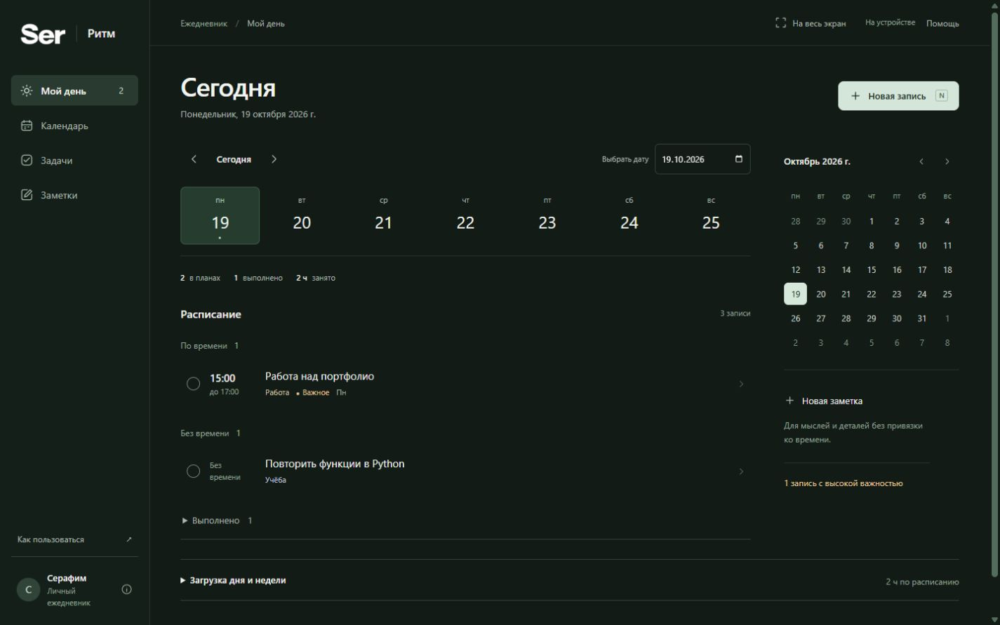
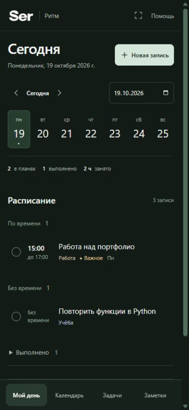

# Ser / Ритм

Календарь, задачи и заметки в Telegram. Мой первый проект для портфолио.

[Открыть бота — @serritmbot](https://t.me/serritmbot)

Бот работает на сервере, компьютер держать включённым не нужно. Отправь `/start` и нажми «Открыть ежедневник». После простоя первый запуск может занять около минуты.



<details>
<summary>Версия для телефона</summary>



</details>

На снимках тестовые записи. При первом входе ежедневник пустой.

## Что умеет

- Показывает расписание дня и календарь на месяц.
- Сохраняет задачи с важностью, временем начала и окончания.
- Повторяет дела каждый день, по будням или в выбранные дни недели.
- Считает загрузку дня и недели, показывает пересечения событий.
- Хранит заметки, ищет записи и выгружает их в JSON.
- Присылает напоминания в личный чат Telegram.

Например, работу по понедельникам с 15:00 до 17:00 достаточно добавить один раз. Каждое повторение можно выполнить или изменить отдельно. Есть и изменение серии с выбранной даты.

На компьютере меню находится слева, на телефоне — внизу. Если Telegram поддерживает полный экран, приложение открывается в нём.

## Запуск на компьютере

Нужен Python 3.11 или новее:

```sh
python -m pip install -r requirements.txt
python server.py
```

Открой [127.0.0.1:8765](http://127.0.0.1:8765/). На Windows можно запустить `start.cmd`. Для локальной версии токен Telegram не нужен.

Если хочешь подключить своего бота, скопируй `.env.example` в `.env` и заполни токен. Дальше — [инструкция для Telegram](docs/telegram.md). Токены и базы в репозиторий не попадают.

## Как устроено

Сервер написан на Python, интерфейс — на HTML, CSS и JavaScript без сборки. Локально записи лежат в SQLite. Для Render добавлено подключение к PostgreSQL: данные хранятся отдельно от приложения и сохраняются при его перезапуске.

Сервер проверяет подпись входа из Telegram и определяет владельца записи по сессии. Данные разных пользователей разделены. Повторения сохраняют исходный часовой пояс; будущие даты рассчитываются при просмотре.

Основной код:

```text
server.py          API и локальный запуск
cloud_wsgi.py      запуск на хостинге
ritm/store.py      SQLite и работа с записями
ritm/postgres.py   PostgreSQL для облака
ritm/recurrence.py повторения и исключения
ritm/bot.py        команды и напоминания
static/           интерфейс
tests/            проверки
```

[Архитектура](docs/architecture.md) · [Повторения](docs/recurrence.md) · [Проверка экранов](docs/responsive.md) · [Размещение на Render](docs/render.md)

## Проверки

```sh
python -m unittest discover -s tests -v
node --check static/app.js
node --test tests/planner.test.cjs tests/fullscreen.test.cjs
```

В GitHub Actions отдельно проверяется PostgreSQL: сохранение, раздельные профили, повторения, перенос SQLite и откат при ошибке. Тесты используют временные базы и не отправляют настоящие сообщения.

## Что ещё нужно доработать

Пока нет импорта через интерфейс, перетаскивания событий и синхронизации с внешними календарями. Повторения по месяцу и году тоже не добавлены.

На бесплатном сервере возможны задержки при открытии и доставке напоминаний. После сбоя уведомление иногда может прийти повторно. Это небольшой личный проект; для большого числа пользователей понадобится другое размещение.
